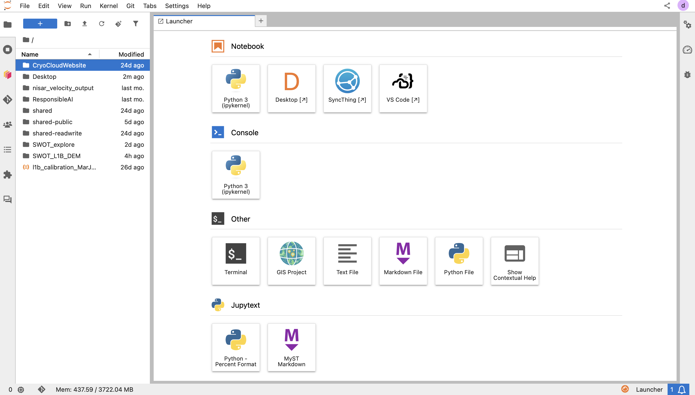

# (2) Navigating JupyterHub

StratusGeo runs on JupyterLab, so if you've used it before, you'll feel at home.
If you haven't logged in yet, start with [Accessing the Hub](./basic_access.md).
New to JupyterHub in general? See the [JupyterHub background guide](../../how_tos/background/jupyterhub.md).

The interface has four parts:

- a **menu bar** across the top
- a **sidebar** on the left (and a second, smaller one on the right)
- a **main work area** in the center
- a **status bar** along the bottom

## Menu bar

The menu bar holds every command in JupyterLab. The ones you'll use most:

| Menu | Common uses |
|------|-------------|
| **File** | Create new notebooks, terminals, and files; save; download; **Log Out** |
| **Edit** | Undo, cut, copy, paste, find and replace; move, split, or merge cells |
| **View** | Show or hide the sidebars and status bar; toggle line numbers |
| **Run** | Run the selected cell, all cells, or all cells above or below |
| **Kernel** | Interrupt, restart, or shut down the kernel; change kernel |
| **Tabs** | Switch between open documents |
| **Settings** | Theme (light or dark), autosave, keyboard shortcuts, and advanced settings |
| **Help** | Links to JupyterLab, Python, and library documentation |

You can also search every command by name with the **command palette**:
press `Ctrl+Shift+C` (`Cmd+Shift+C` on a Mac).

## Sidebar

The left sidebar is a column of icons. Click an icon to open that panel, and
click it again to collapse it and give your work more room. You can also toggle
the whole sidebar with `Ctrl+B` (`Cmd+B` on a Mac) or **View → Show Left Sidebar**.

| Icon | Tool | Use it to... | Learn more |
|------|------|--------------|------------|
|  | Files | Browse `/home/jovyan`, upload, rename, delete, or clone a repo | [Data Storage](../../how_tos/data_storage/index.md) |
|  | Running sessions | See and shut down open kernels, terminals, and tabs | [Hub Best Practices](../hub_best_practices.md) |
|  | Dask | Configure workers and watch performance (if enabled) | [Dask for Geoscientists](../../tutorials/Dask/dask_for_geoscientists.ipynb) |
|  | Git | Commit, branch, and push without the command line | [Using Git](./using_git.md), [Git basics](../../how_tos/background/git.md) |
|  | Contents | Jump between headings in the open notebook or markdown file | |
|  | Extensions | Find and install JupyterLab extensions | |

Your sidebar may differ slightly depending on the environment you selected.

### The file browser

The file browser opens at your home directory, `/home/jovyan`. From here you can:

- **Open** a file by double-clicking it.
- **Upload** files with the upload arrow at the top of the panel, or by
  dragging them from your computer into the panel.
- **Create** a folder with the new-folder button.
- **Right-click** any file for more options: rename, delete, duplicate,
  download, copy path, or **Open With** (for example, opening a notebook as plain text).
- **Navigate** using the breadcrumb path above the file list. Click the house
  icon to return to your home directory.

Uploading through the browser works best for small files. For large datasets,
see [Data Storage](../../how_tos/data_storage/index.md).

### Running sessions

Every open notebook keeps a **kernel** running, which uses memory even when you
aren't working in it. Closing a tab does **not** stop its kernel. Use the
Running sessions panel to see what's active and click **Shut Down** next to
anything you're finished with. This frees resources for you and keeps costs
down for the community.

### The right sidebar

A smaller sidebar on the right holds the **Property Inspector** (cell and
notebook metadata, such as cell tags) and, in recent versions, the
**Debugger**. Most users rarely need it.

## Main work area

Everything you open appears as a **tab** in the main work area: notebooks,
terminals, Python consoles, text and markdown editors, and viewers for images,
CSV files, and PDFs.

**Arranging tabs.** Drag a tab to the edge of the work area to split the view,
or onto another tab group to stack them. This makes it easy to keep a notebook
beside a terminal or a reference doc. Your layout is remembered the next time
you log in.

**Unsaved changes.** A dot on a tab means it has unsaved changes. Save with
`Ctrl+S` (`Cmd+S`). JupyterLab also autosaves notebooks periodically.

**Focusing on one document.** Turn on **Simple Interface** (**View → Simple
Interface**, or `Ctrl+Shift+D`) to show one document at a time. Turn it off to
return to tabs.

### The notebook toolbar

When a notebook is open, a toolbar appears at the top of it with buttons to:

- save the notebook
- insert a cell below
- cut, copy, and paste cells
- run the selected cell
- interrupt or restart the kernel
- change the cell type (Code, Markdown, or Raw)

At the right end of the toolbar is the **kernel name** (click it to switch
kernels) and a **status circle**: empty means idle, filled means the kernel is
busy running code. For more on working in notebooks, see
[Using Notebooks](./using_notebooks.md).

### Starting something new

Click the **+** at the top of the file browser to open the **Launcher**, a grid
of tiles for creating notebooks, consoles, terminals, and text or markdown
files. You can also use **File → New Launcher**. Your environment image may
add more tiles.

- For working in notebooks, see [Using Notebooks](./using_notebooks.md).
- For the terminal and version control, see [Using Git](./using_git.md).

## Status bar

The status bar runs along the bottom of the screen and shows what's happening
in the current document. Depending on what you have open, it can show:

- **Kernel name and status**, such as `Python 3 | Idle`. Click it to change kernels.
- **Running terminals and kernels**, as a count. Click it to open the Running
  sessions panel.
- **Notebook mode**: *Command* (navigating between cells) or *Edit* (typing in a cell).
- **Cursor position** (line and column) when editing a file.
- **Memory use**, in environments with the `jupyter-resource-usage` extension.
  Keep an eye on this when working with large datasets. If you're near your
  limit, shut down unused kernels.

To hide or show the status bar, use **View → Show Status Bar**.

## A note on storage

Your home directory persists between sessions, but it has a per-user quota and
isn't meant for large or intermediate datasets. Keep code and small files
there. For larger or temporary data, use the
[scratch bucket](../../how_tos/data_storage/CryoCloud_Scratch_Bucket.ipynb), and see
[Data Storage](../../how_tos/data_storage/index.md) for all the options.

## Logging out and stopping your server

Closing your browser tab does **not** stop your server. When you're done:

1. Save your work.
2. Go to **File → Hub Control Panel**.
3. Click **Stop My Server**.

Logging out (**File → Log Out**) without stopping the server may leave it
running until it times out. See [Hub Best Practices](../hub_best_practices.md).